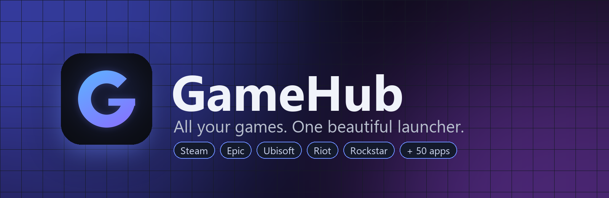
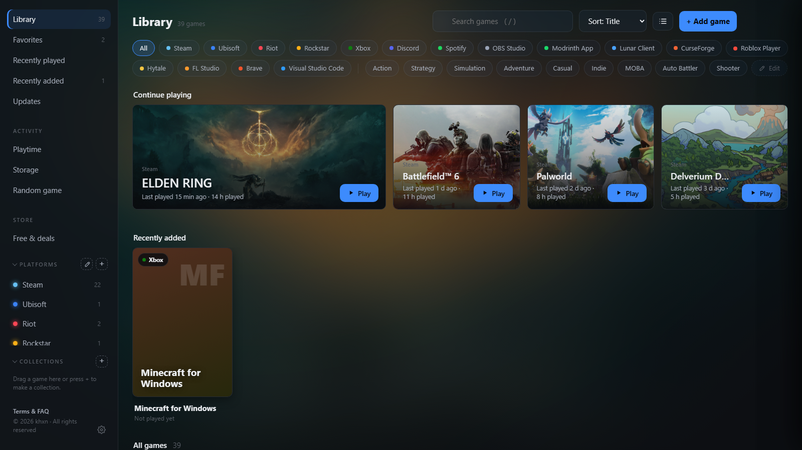
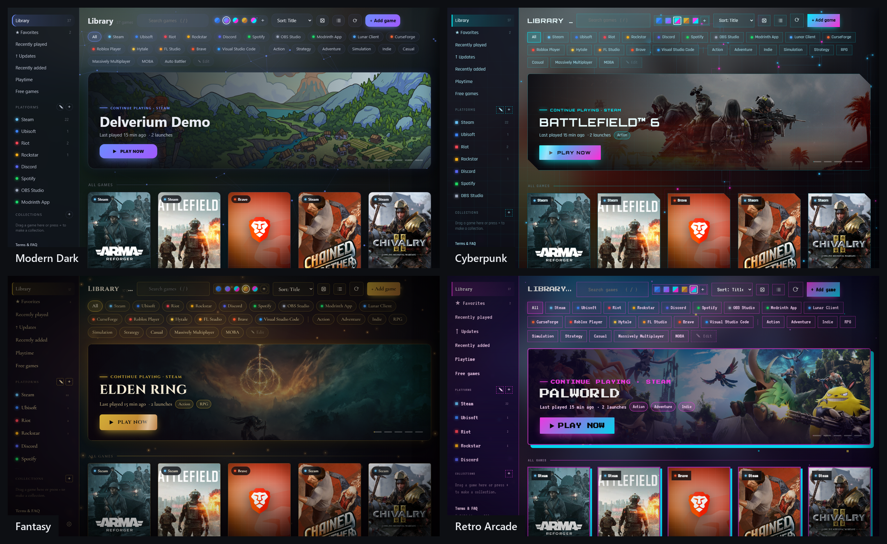

<div align="center">



[](https://github.com/Khxn-alt/gamehub-releases/releases/latest/download/GameHub-Setup.exe)


</div>

<p align="center">
  
</p>

## About

GameHub shows the games from Steam, Epic Games, Ubisoft Connect, Riot Games, Rockstar Games, Xbox, EA app, GOG and Battle.net in one library.
Games are found automatically and start through their own launcher.

## Features

**Library**
- Games from Steam, Epic, Ubisoft, Riot, Rockstar, Xbox, EA app, GOG and Battle.net, with cover art
- Home page with continue playing, recently added and your collections
- One-click launch
- Update status for Steam games, including download progress
- Favorites, recently played, recently added
- Collections, renaming, hiding and notes per game
- Grid or list view

**Playtime**
- Tracks time per game, also when a game is started outside GameHub
- Weekly totals and a 14-day overview
- Play sessions and a calendar of when you played
- Shows which game is running, with an option to close it
- Profile card to share, with your own picture, colour and layout

**Game details**
- News and patch notes for Steam games
- Steam achievement progress (requires your own Steam Web API key)
- Install size and a shortcut to the install folder
- Choose posters, banners and logos from SteamGridDB (requires a free API key)

**Storage**
- Space used per drive and per game, largest first
- Shows games you haven't played in 3 months

**Free & deals**
- Free games from the Epic Games Store and Steam, with an alert
- Steam and Epic Games sales, with filters by store and discount
- Sales on your Steam wishlist

**Other**
- Random game picker
- Controller support (Xbox and PlayStation)
- 280 supported apps, such as Discord, Spotify, OBS, Roblox, Modrinth and CurseForge
- Discord status
- Five themes and a theme editor

## Themes

Graphite is the default theme (shown above). The other built-in themes:

<p align="center">
  
</p>

## Supported apps

**Launchers:** Steam, Epic Games, Ubisoft Connect, Riot Games, Rockstar Games, GOG Galaxy, EA app, Battle.net, itch.io, Heroic, Playnite, Amazon Games, Minecraft Launcher, Overwolf, HoYoPlay

**Minecraft:** Modrinth, CurseForge, Lunar Client, Prism Launcher, ATLauncher, MultiMC, TLauncher, Badlion, Feather

**Games:** Roblox Player and Studio, Bloxstrap, FiveM, Hytale, osu!, RuneLite, Jagex Launcher

**Emulators:** RetroArch, Dolphin, PCSX2, RPCS3, DuckStation, PPSSPP, Cemu, Ryujinx, Xenia and more

**VR:** SteamVR, Meta Quest Link, Virtual Desktop, ALVR

**Social and streaming:** Discord, Spotify, OBS Studio, Streamlabs, Medal, TeamSpeak, Voicemod

**Hardware:** NVIDIA App, AMD Software, MSI Afterburner, iCUE, SteelSeries GG, Razer Synapse, Logitech G HUB

**Creative and development:** FL Studio, Blender, Unity Hub, DaVinci Resolve, CapCut, Ableton Live, VS Code, Notepad++, Brave, Chrome, Edge

And a lot more.

Apps are added with the **+** next to *Platforms*. Only installed apps can be added.
CurseForge and Modrinth show your modpacks, and FL Studio, Blender and VS Code show your recent projects.

## Install

1. [Download GameHub-Setup.exe](https://github.com/Khxn-alt/gamehub-releases/releases/latest/download/GameHub-Setup.exe)
2. Run the installer. Administrator rights are not required.
3. Start GameHub from the Desktop or Start menu.

Windows SmartScreen may show "unknown publisher". Click **More info**, then **Run anyway**.
See [Windows Defender and antivirus warnings](#windows-defender-and-antivirus-warnings) below.

**Updates:** GameHub checks for updates on start. Every update is signed and is rejected if it was modified.

**Uninstall:** Windows Settings > Apps > GameHub, or run the installer again.

## Windows Defender and antivirus warnings

GameHub is not yet code-signed. A code-signing certificate is paid and is not used for my project.
Windows and antivirus programs trust unsigned programs less, and their machine learning scanners sometimes mark
them as malware when they are not.

GameHub is a Python program packaged with PyInstaller. PyInstaller programs are often hit by these detections,
because malware is packaged the same way.

**Known detections**

| Version | File | Detection | Status |
|---|---|---|---|
| 1.0.16 | `GameHub.exe` | `Trojan:Win32/Bearfoos.A!ml` (Windows Defender) | False positive, reported to Microsoft |

A detection name that ends in `!ml` comes from Defender's machine-learning model, not from a known malware sample.
On [VirusTotal](https://www.virustotal.com/gui/file/cbb7fee4adf519e71387e93fb4d3a52e3a7c897a874f17c5b511c725a1506450),
3 of 71 scanners flag the 1.0.16 file, all on generic or machine-learning rules.

**Check that your file is the original**

Every release lists the SHA256 of `GameHub.exe`. Compare it with your file in PowerShell:

```powershell
Get-FileHash "$env:LOCALAPPDATA\Programs\GameHub\GameHub.exe"
```

If the hash does not match the one in the release, do not run the file and [download](https://github.com/Khxn-alt/gamehub-releases/releases/tag/v1.0.16) GameHub again

**If Defender removed GameHub.exe**

1. Open **Windows Security** > **Virus & threat protection** > **Protection history**.
2. Open the entry for `GameHub.exe`, check that the path is your GameHub folder.
3. Choose **Actions** > **Allow** (or **Restore**).

Only do this for a file whose hash matches the release. You can also wait for Microsoft to update its definitions;
after that, run the installer again.

**What GameHub does and does not do**

- It reads install information from your launchers and starts games through them.
- It runs a small web page for its own window on `127.0.0.1` only; it cannot be reached from other computers.
- It does not ask for passwords and does not send your data to the developer.
- It only installs updates that carry the developer's signature.

Antivirus problems with GameHub can be reported under [Issues](https://github.com/Khxn-alt/gamehub-releases/issues).

## FAQ

<details><summary><b>Does GameHub need my passwords?</b></summary>

No. GameHub does not ask for or store login details. It reads the install information on your PC and starts games
through each launcher.
</details>

<details><summary><b>Is it free? Is it open source?</b></summary>

It is free for personal, non-commercial use. It is not open source.
</details>

<details><summary><b>Where is my data stored?</b></summary>

In <code>%APPDATA%\GameHub</code>. Nothing is sent to the developer. Artwork, genres, news and giveaways are loaded from
the public Steam, Epic Games and Wikipedia websites.
</details>

<details><summary><b>Why does a game show "Update available"?</b></summary>

GameHub reads the local update status from Steam, including progress. For Epic it only detects incomplete installs.
Ubisoft and Riot games update when you start them.
</details>

## License

© 2026 khxn. All rights reserved.

GameHub is for personal, non-commercial use. Copying, redistributing, selling or reusing GameHub or its code, design,
themes or logo is not allowed without written permission. Game names, covers and logos belong to their owners.
GameHub is not affiliated with Valve, Epic Games, Ubisoft, Riot Games or Rockstar Games.
